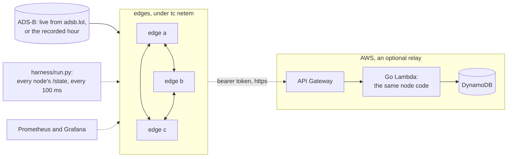
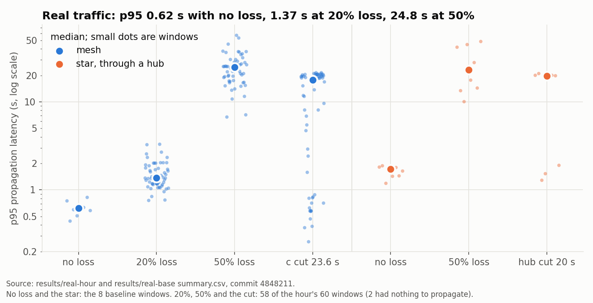
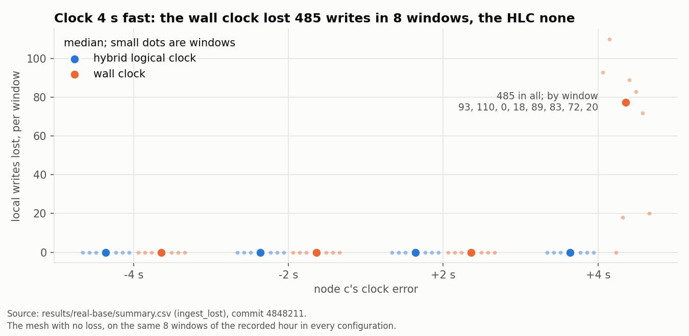
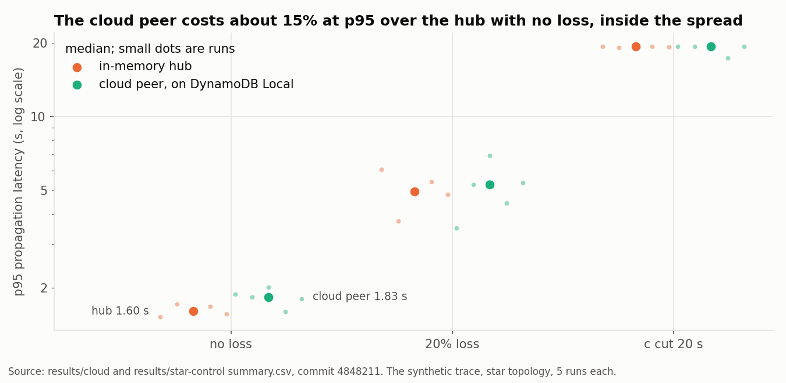
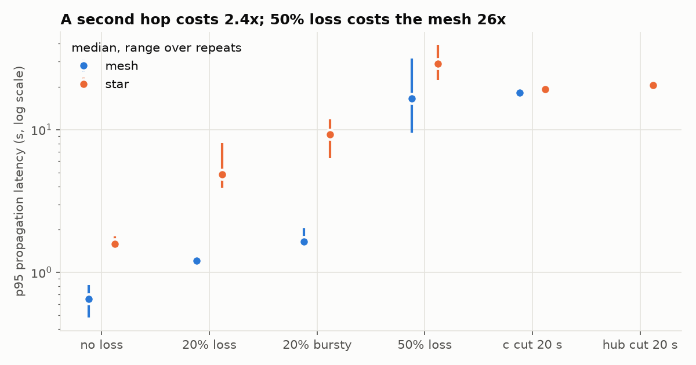
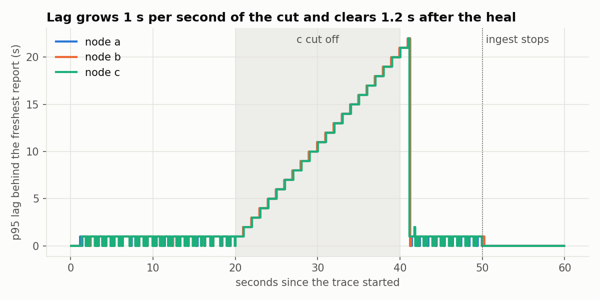
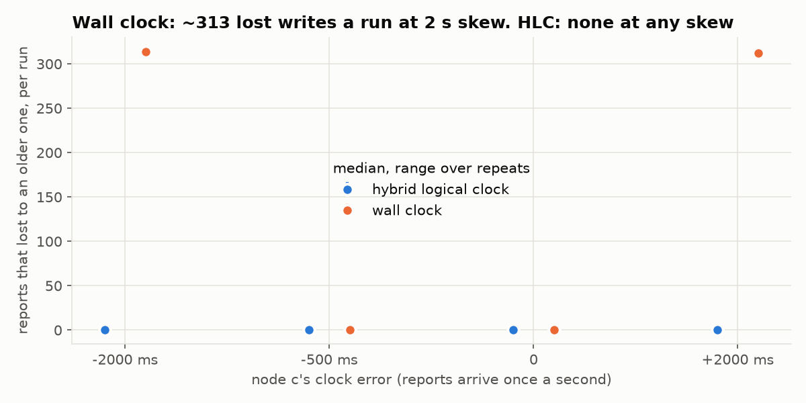
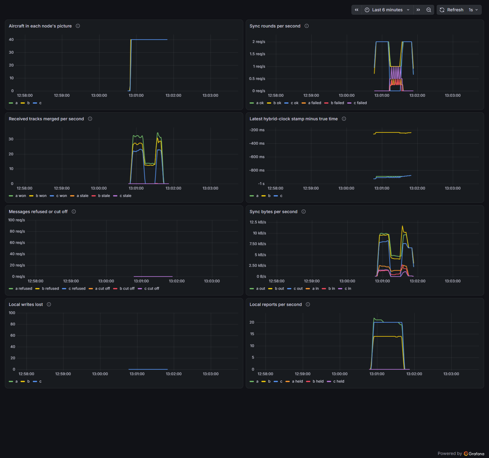

# holdfast

[](https://github.com/haeganm/holdfast/actions/workflows/ci.yml)

Edge nodes that keep one shared picture of the aircraft around them while the network between them drops packets or cuts out, a cloud peer that runs the same merge code in a Go Lambda on DynamoDB, and a harness that measures how well they hold up on real ADS-B traffic.

Three nodes in Docker each take in position reports for their own coverage area, keep a replica of the shared picture, and sync peer to peer by anti-entropy over HTTP while `tc netem` drops packets or cuts a node off. Reports come from a recorded hour of real traffic over Washington DC, from the live feed, or from a synthetic trace with exact ground truth. Every number below traces to a committed file or to the raw-data release: a `summary.csv` written by [`harness/run.py`](harness/run.py), the recorded trace through [`harness/trace_stats.py`](harness/trace_stats.py), the AWS runs' record in [`results/aws`](results/aws), or the raw polls in [recorded-hour-raw](https://github.com/haeganm/holdfast/releases/tag/recorded-hour-raw). Each set of predictions was committed before the runs that grade it: [docs/predictions.md](docs/predictions.md) for the synthetic sweep, [docs/predictions-2.md](docs/predictions-2.md) for real traffic, live and the cloud peer. Anything decided after seeing data says so where it appears, and [how the runs were checked](#how-the-runs-were-checked) lists the reruns and the rest.

## Results

- **Real traffic, under loss and partitions.** On an hour of recorded ADS-B over Washington DC (444 aircraft), replayed window by window: under 20% packet loss a report took 1.37 s at p95 to reach another node, and all 60 windows converged; after node c was cut off for 23.6 s, every node held everything again within 1.4 s of the heal, in all 60 (0.9 s median over the 45 with traffic during the cut). 50% loss is where request/response sync over TCP breaks: p95 24.8 s, and 27 of 60 windows converged, 12 of them with no reports in their last 20 s. [Details](#results-the-recorded-hour).
- **Clocks.** With one node's clock 4 s fast, a wall-clock last-writer-wins map threw away 485 fresh reports across eight windows and ended with 81 aircraft wrong; the hybrid logical clock lost none. A model of the trace, written after these runs, accounts for the wall clock's losses to the unit: it counts 93, 110, 0, 18, 89, 83, 72 and 20, exactly what the harness measured. [Details](#baselines-the-central-server-and-the-clock).
- **The central-server baseline.** Relaying through a hub cost 2.8 times the mesh's p95 with no loss (2.5 with two stalled runs in place of their reruns), and cutting the hub stopped all merging between nodes, where the mesh kept the uncut nodes merging. [Details](#baselines-the-central-server-and-the-clock).
- **Live, and the cloud peer.** Three nodes on live ADS-B delivered each other's reports in 0.62 s at p95, while the feed itself takes 0.75 s. The cloud peer, the node's own code running per request on DynamoDB, relayed within 15% of an in-memory hub, and deployed on AWS it carried live traffic between three edges at 2.1 s p95, for under half a cent. [Live](#results-live-traffic), [cloud](#results-the-cloud-peer).
- **Predictions first.** Thirteen predictions were committed before these runs: ten held, one held in part, and two failed. Each is graded [below](#predictions-graded-real-traffic-live-and-the-cloud-peer), failures included.

## How it works



Each node keeps a map from aircraft to a last-writer-wins register stamped with a hybrid logical clock (HLC). Nodes sync by anti-entropy: send a digest, get back what you are missing, send what the peer is missing. Merge is a max over a total order (stamp, then origin, then contents), so the map is a CRDT: replicas converge whatever order messages arrive in and however often they are lost or repeated, provided that

- every pair of nodes eventually completes a sync round, directly or through other nodes
- the spread between the fastest and slowest physical clock stays under the max drift (5 s by default), since a node rejects stamps further ahead of its own clock than that
- the live picture has at most 10,000 aircraft, the most one digest may carry. A replica never holds more: once full it refuses new aircraft until expiry makes room. An aircraft nobody has reported for 5 minutes expires on every node, which keeps a live picture far below that.

A lost exchange is never retried. The next tick is the retry, 1 s after a round ends, which is safe because every exchange is idempotent. A restarted node holds its own reports for the max drift before stamping them, so nothing it stamps can sort below what its previous run wrote.

The cloud peer ([`cloud/`](cloud)) is a node behind API Gateway and a Go Lambda, with the picture in DynamoDB. Each request scans the table, rebuilds a node from it, runs that node's own HTTP handler, and writes back every track that changed with a conditional put that only lets a greater track in (or a valid one over a corrupt item: one that doesn't decode, whose ord isn't its track's, or that no clock would accept). `crdt.Ord` encodes the merge order as a string DynamoDB can compare, so concurrent invocations and retried writes can only move an item up. [`cloud/terraform`](cloud/terraform) creates it on demand with nothing provisioned, so it costs nothing while idle. Edges send it a bearer token through `-cloud-peer`, which sends the token to that host only, and only over https or to a private address, never through a proxy in the clear.

[docs/DESIGN.md](docs/DESIGN.md) has the layers, every invariant with the test that enforces it, and what happens under each kind of failure.

## Setup

Three edge nodes with 60 km coverage circles. a sits 69 km from each of the other two, so it overlaps both, and b and c (138 km apart) don't overlap at all. The harness polls every node's `/state` every 100 ms over a control network netem never touches. Topologies:

- **mesh**: every edge syncs with every other edge
- **star**: edges sync only with a hub that has no coverage of its own, the central-server baseline. The hub only answers and never starts a round, so each edge-hub link carries one round per second where a mesh pair carries two: part of what the star costs comes from that, not only from the second hop.
- **cloud**: the star, with the cloud peer on DynamoDB Local as its hub

Where reports come from:

- **The recorded hour**: [`traces/adsb-2026-11-05.jsonl.gz`](traces/adsb-2026-11-05.jsonl.gz), from adsb.lol, 2026-11-05 18:17 to 19:17 UTC. 28,160 reports of 444 aircraft, 71% of them seen by two or more sensors. The recorder asked the feed for one 70 nm circle around all three sensors every 3 s, handing each answer to the next sensor in turn. That was about twice what the feed answers (10 requests a minute), so the recording is bursty: nearly every minute, about 27 s of answers, then about 33 s waiting out a refusal (68 of 669 requests failed). One request every 6 s, the pace of the live and AWS runs, drew no failures. So a sensor heard its circle every 9 s at the median but every 18 s on average, and 55% of the hour falls in gaps over 6 s with no report from anyone. The feed's delay from observation to receipt was 0.89 s median and 22 s at p99, mostly aircraft on the ground, whose positions update rarely: 76% of the reports over 20 s old were on the ground or moving under 40 kt. Under the ODbL, see [traces/NOTICE](traces/NOTICE).
- **Live**: each edge polls adsb.lol for its own circle every 18 s, the three 6 s apart.
- **Synthetic**: [`traces/seed1.jsonl`](traces/seed1.jsonl), 40 aircraft reporting once a second, 16 of them seen by two nodes. Ground truth is exact, and two nodes that cover an aircraft ingest the identical report at the same moment.

Scenarios: no loss, 20% and 50% i.i.d. loss, 20% bursty loss (Gilbert-Elliott), node c cut off from 40% to 80% of the ingest window, and the star's hub (or the cloud peer) cut off over the same span. netem drops on egress, so a loss rate applies once per hop in each direction.

Metrics, defined in the [`run.py`](harness/run.py) docstring:

- **time to convergence**: `settle_ms`, from ingest stopping until every node's replica hash is equal; after a partition, `catchup_merge_ms`, from the heal until every edge holds everything any edge held at the heal
- **divergence**: at each poll, the share of aircraft on which the edges don't all hold the same value
- **staleness**: age of information. At each poll, for each edge and each aircraft whose latest report reached some edge in the last 5 s, how old the observation it holds is. p50 and p99.
- **bytes per useful update**: bytes on the mesh interfaces during ingest, headers and retransmits included, divided by the merges over the same window that changed an edge's picture. The star's hub and the cloud peer only relay, so their merges don't count.
- **propagation latency**: for each report and each other edge, the time until that node holds the report or something fresher. On real traffic it counts from the report's first receipt by any node, so the feed's own delay, reported on its own, doesn't count against sync. A node that already held something fresher when the report arrived counts as reached at once.
- **lost local writes** (`ingest_lost`): a node's fresh report lost a merge to an older one. Under the HLC this can't happen.
- **merged during the cut** (`merged_cut`): tracks the edges merged from each other from one client timeout (2 s) after a cut began until the heal, so nothing already in flight counts.

## Results: the recorded hour

Source: [`results/real-hour/summary.csv`](results/real-hour/summary.csv), commit 4848211 (the rows say `-dirty`, see [how the runs were checked](#how-the-runs-were-checked)): the mesh under the hybrid clock, under 20% loss, 50% loss and a cut of node c, each condition replaying all 60 windows of 59 s (3,540 s of the 3,582 s recording). c is cut from 40% to 80% of each window, 23.6 s. The no-loss row is the mesh on the eight baseline windows below. Two windows, 649 to 708 s and 885 to 944 s, have nothing to propagate (no reports at all in the first, 52 from a single sensor in the second: the feed was refusing the recorder), so the propagation, staleness, divergence and bytes columns are over the other 58. Medians, with min-max over windows; times in ms.

| network | settled | settle | prop p50 | prop p95 | prop p99 | never delivered | staleness p50 | staleness p99 | divergence | catch-up | merged during the cut | sync errors | bytes per useful update |
|---|---|---|---|---|---|---|---|---|---|---|---|---|---|
| no loss (8 windows, below) | 8/8 | 55.5 (15-64) | 411.5 (240-601) | 618.5 (446-824) | 620.5 (446-824) | 0% | 3544 (1852-3839) | 30525.5 (18439-37287) | 5.8% (2.1%-33.3%) |  |  | 0% | 2306 (1899-4195) |
| 20% loss | 60/60 | 55 (5-944) | 644 (401-1121) | 1368.5 (763-3320) | 1508.5 (763-3320) | 0% | 3800.5 (2680-4118) | 32807 (9384-55711) | 7.3% (0.4%-45.8%) |  |  | 4.8% (0.8%-8.6%) | 2555 (1178-11665) |
| 50% loss | 27/60 | 1329 (1-9407), 33 never | 6158.5 (2866-14712) | 24817 (6774-57647) | 25548.5 (6774-62492) | 4.3% (0%-54.5%) | 5813.5 (2748-7478) | 39063 (9390-57032) | 76% (14.1%-100%) |  |  | 75.1% (39.1%-89.1%) | 1786 (964-4087), 1 never |
| c cut 23.6 s | 60/60 | 40.5 (0-297) | 385 (84-3073) | 17823.5 (260-21672) | 20830 (376-24674) | 0% (0%-0.9%) | 3964.5 (2606-5008) | 30929.5 (9398-55791) | 32.2% (0.2%-69.2%) | 802 (0-1323) | 98.5 (0-234) | 7.9% (7.9%-8%) | 2641 (1253-10732) |



What the data says:

- **20% loss costs about 0.75 s at p95.** A report took 1.37 s at p95 to reach another node, against 0.62 s with no loss, and every window settled within 10 s of ingest stopping.
- **50% loss is where it breaks, on real traffic as on the synthetic trace.** p95 rose to 24.8 s, three quarters of sync rounds failed, and fewer than half the windows settled (27 of 60). 12 of those 27 had no reports in their last 20 s or more, which gave sync that much longer; of the 45 windows with reports in their last 20 s, 15 settled. It is worse than the synthetic trace's 16.6 s, as predicted: a round here carries a digest of about 108 aircraft instead of 40, so more packets have to get through.
- **A cut node is caught up in under 1.4 s.** After the 23.6 s cut, every edge held everything any edge had held at the heal within 802 ms (median), 1323 ms at worst, in all 60 windows. That includes 15 windows where no report arrived during the cut, so there was nothing to catch up; over the other 45 the median was 915 ms. Through the cut, a and b kept merging each other's reports (98.5 tracks, median; 150 over those 45).
- **The registered catch-up column asks more than sync can give.** `catchup_ms` waits until every edge holds an observation at least as new as the newest made before the heal, and last-writer-wins can keep a later write of an older observation, so in 21 of 60 windows it never completed while every edge held the same value. Its median, counting those as never, is still 1157 ms.
- **Staleness is mostly the sensors, not the sync.** What a node holds is 3.8 s old at the median under 20% loss (3.5 s with no loss), and its p99 of about 30 s is positions the feed delivered late: each sensor hears its circle every 9 s at the median while the feed answers, and the feed takes 0.88 s at the median to deliver a position and 22 s at p99. Staleness only counts aircraft some edge got a report of in the last 5 s, so the feed's silences don't enter it.


### How the runs were checked

- **Eight runs were rerun.** Four here and four in the baselines had harness polls time out while the PC was busy, so their polls have holes. A rule written before any rerun set aside every run with a poll error, or a mean poll interval over 101 ms, and reran it at the same commit; no final run has a poll error. The first versions are in `summary-before-rerun.csv` beside each `summary.csv`. Two results move with them: the hub's cost with no loss would read 2.46x instead of 2.8x, and the hybrid clock's merge regressions across the partition 255 instead of 187.
- **The rows say `4848211-dirty`.** At that commit the harness called a checkout dirty whenever `git status` printed anything, and the sweep's own results directories are untracked but not ignored, so every family after the first (live, labelled 4848211) read dirty. No tracked file changed in that checkout during the sweep; work went on in a separate git worktree. Since 6e1246d the check leaves `results/` out, and since a1b9a5d a dirty label also carries a short hash of what differs, so two dirty trees can't share one.
- **The recording's silences flatter two results** (above): 15 of the 60 cut windows had nothing to catch up, and at 50% loss, 12 of the 27 windows that converged had a quiet last 20 s.
- **Three columns were redefined after an independent review, by reanalysis, with nothing rerun.** Staleness had kept aircraft *observed* in the last 5 s, which left out exactly the positions the feed delivered late; it now keeps aircraft whose latest report *arrived* in the last 5 s, as its definition always said, and its p99 rose about threefold. Bytes per useful update had counted the star hub's relay merges and merges made after the bytes stopped; it now counts the edges' merges over the bytes' own window, so the mesh's premium over the star fell from 2.7x to 1.8x. Propagation samples are now clamped at 0, for a node that already held something fresher, which moves no published cell. Each directory keeps its summary from before as `summary-before-audit.csv`.
- **A control run after the audit's fixes.** At c6671df, with every runtime fix in, the baselines' window 0 was run again in all 16 configurations ([`results/audit-control/summary.csv`](results/audit-control/summary.csv)). What the trace determines came out identical: lost local writes (93 under the wall clock 4 s fast, with no loss and with 20%, 28 across the partition, 0 in every other run), aircraft wrong at the end, and which runs settled. Propagation p95 sat inside the committed eight-window range in 14 of the 16 and within 5% of its top in the other two; one window's p95 varies a lot from run to run (here from 0.44 to 2.8 times the committed run's). And the heal race went the other way again: across the partition the hybrid clock had 68 merges an older report won and the wall clock none, the reverse of the committed runs.
- **One model came after the runs.** `expected_wall_losses` in [`harness/trace_stats.py`](harness/trace_stats.py) (commit 81871f8) counts the writes a skewed wall clock must lose, from the trace alone. It matches the measured losses window by window, but it was written once those numbers were in, so it explains them; it didn't predict them.

### Baselines: the central server and the clock

Source: [`results/real-base/summary.csv`](results/real-base/summary.csv), commit 4848211 (labelled `-dirty`, [see above](#how-the-runs-were-checked)): eight windows of 50 s, one every 7.5 minutes. Every configuration replays the same eight windows, so a difference between configurations is not a difference in traffic. Medians, with min-max over windows; times in ms.

| configuration | settled | prop p50 | prop p95 | never delivered | staleness p50 | staleness p99 | divergence | merged during the cut | sync errors | bytes per useful update |
|---|---|---|---|---|---|---|---|---|---|---|
| mesh, no loss | 8/8 | 411.5 (240-601) | 618.5 (446-824) | 0% | 3544 (1852-3839) | 30525.5 (18439-37287) | 5.8% (2.1%-33.3%) |  | 0% | 2306 (1899-4195) |
| star, no loss | 8/8 | 1137.5 (970-1290) | 1731.5 (1196-1888) | 0% | 4001 (1892-4204) | 31275 (19318-40237) | 18.6% (6.1%-64.7%) |  | 0% | 1287 (1080-2756) |
| star, 50% loss | 0/8 | 9031 (5988-15876) | 23035 (10159-48882) | 54.5% (43.6%-71.4%) | 6074 (1871-7398) | 36576 (31636-49291) | 99.6% (99%-100%) |  | 61.4% (28.2%-74.7%) | 2076 (1633-3618), 1 never |
| star, hub cut 20 s | 8/8 | 4751 (629-6026) | 19591.5 (1294-20998) | 0% (0%-0.2%) | 4834 (1843-5421) | 34642.5 (26036-43434) | 64.5% (5.5%-77.8%) | 0 | 12.7% (11.5%-12.8%) | 1216 (980-1801) |

- **A central server costs 2.8x with no loss**: p95 1.73 s against the mesh's 0.62 s, and slower in all eight windows. With the stalled first runs of windows 1 and 7 in place of their reruns it reads 2.46x (1.52 s), still slower in all eight.
- **Cutting the hub stops everything**: no edge merged anything from another once the cut was in force, in all eight windows.
- **At 50% loss through a hub, more than half of all deliveries never happen** (54.5%, median), and no window settled.
- **The mesh pays 1.8 times the bytes per useful update** (2,306 against 1,287): every round carries the versions of the whole picture whether anything changed or not, and the mesh runs twice as many rounds as the star (every pair syncs both ways, against one round per edge with the hub). Paged or Merkle-range digests would cut it (see [docs/DESIGN.md](docs/DESIGN.md)).

Clock skew, node c's clock off by the skew, mesh. Totals over the same eight windows, with the range per window:

| clock | c's clock | network | lost local writes | merges an older report won | aircraft wrong at the end |
|---|---|---|---|---|---|
| hybrid | 4 s slow, 2 s slow, 2 s fast, 4 s fast | no loss | 0 (0-0) | 20 (0-8) | 4 (0-2) |
| wall | 4 s slow, 2 s slow, 2 s fast | no loss | 0 (0-0) | 20 (0-8) | 4 (0-2) |
| wall | 4 s fast | no loss | 485 (0-110) | 2 (0-2) | 81 (0-28) |
| hybrid | 4 s fast | 20% loss | 0 (0-0) | 20 (0-8) | 4 (0-2) |
| wall | 4 s fast | 20% loss | 485 (0-110) | 2 (0-2) | 81 (0-28) |
| hybrid | 4 s fast | c cut 20 s | 0 (0-0) | 187 (0-72) | 4 (0-2) |
| wall | 4 s fast | c cut 20 s | 181 (0-36) | 245 (0-72) | 81 (0-28) |

Columns are `ingest_lost`, `merge_regress` and `wrong_final` (an aircraft whose final value is older than the freshest observation any edge made).



What the data says:

- **The wall clock loses exactly the writes the trace says it must.** With c 4 s fast, a report loses when it lands less than 4 s after c's report of the same aircraft and is fresher than it. [`harness/trace_stats.py`](harness/trace_stats.py) counts those from the trace alone, with no run: 93, 110, 0, 18, 89, 83, 72 and 20 in the eight windows. The harness measured 93, 110, 0, 18, 89, 83, 72 and 20. The model was written after these runs (commit 81871f8) to explain them; it wasn't a prediction, and prediction 8 below failed.
- **Which way the clock is off matters as much as by how much.** With c 4 s slow, or 2 s off either way, the wall clock lost nothing, because of how the sensors take turns: c never reports less than 5.4 s after a, and a never less than 2.67 s after c. On the synthetic trace, where every aircraft reports once a second, 2 s of skew cost 312 to 315 writes a run.
- **On real traffic the losses cost correctness, not just freshness.** The wall clock ended with 81 aircraft showing an older position than the freshest any node had. The hybrid clock ended with 4, the same 4 as every other configuration that converged, the wall clock 4 s fast aside: those come from the feed delivering old positions late, which last-writer-wins doesn't fix (it orders writes, not observations). The 20 merges an older report won, under both clocks alike, are the same effect.
- **Across a partition, both clocks face the same race at the heal.** Writes made on opposite sides of a cut can only be ordered by physical time, and c's runs 4 s fast. So if the first sync round after the heal lands before c's next report, c's older reports beat a's newer ones under either clock, until that next report replaces them about a second later. Both clocks were caught alike in three windows (72, 57 and 48 merges). In window 0 only the wall clock was (68): the hybrid clock's first round after the heal came 1.3 s in, after c had reported again, so c's fresh reports arrived first. That run is one of the eight rerun after stalled polls, and its stalled first run had been caught too, with 68: the same race, going the other way. What the hybrid clock adds is everything around the heal: it lost no write, where the wall clock also lost 181 (38 before the cut, 63 in its first 1.3 s to reports c had sent just before it, 80 after the heal) and ended with 81 aircraft wrong.
- **20% loss changes nothing here.** Every report still reaches the next node well inside the 2.67 s before the next handoff.

## Predictions, graded: real traffic, live and the cloud peer

Graded against [docs/predictions-2.md](docs/predictions-2.md) as registered (commit d78938d, before any of these runs). Its corrections section records what the file got wrong or left unclear about the trace and the windows. It was added while the runs were going (4a86708 and 7f23655 during the baselines, 8e4a88e as the recorded hour began), and none of it changes a prediction.

| # | prediction | result |
|---|---|---|
| 1 | every no-loss and partition run settles; most at 20% loss; fewer than half at 50% | **held**: every no-loss run (80 of 80) and every partition run (60 of 60, and 16 of 16 in the baselines, with all 8 hub cuts too) settled; 20% loss 60 of 60 (16 of 16); 50% loss 27 of 60 in the mesh and 0 of 8 through the star |
| 2 | propagation p95 rises with loss, and at 50% beats the synthetic 16.6 s | **held**: 618.5 < 1368.5 < 24817 ms (medians), and 24.8 s against the synthetic 16.6 s. At 50% loss 4.3% of deliveries never happened (median, up to 54.5%), which the percentile leaves out; counting them would only raise it |
| 3 | after the heal, every node holds everything reported before it within 2 s (median) | **held**: 1157 ms by the registered column, counting its 21 never-completed windows as never; in merge order, 802 ms median and 1323 ms at worst, in all 60 windows (see above for why the two differ) |
| 4 | the star is slower than the mesh with no loss, and with the hub cut the edges merge nothing from each other | **held**: slower in all eight windows (p95 1731.5 against 618.5 ms, medians), and nothing merged between edges during the hub cut in 8 of 8 |
| 5 | `rejected` and `ingest_lost` are 0 in every hybrid-clock run | **held**: 0 and 0 in all 260 |
| 6 | regressions above 0 in most windows, at about the trace's rate, under both clocks alike | **held in part.** Above 0 in 38, 35 and 36 of the 60 windows (20%, 50% loss, cut), where the trace has late reports in 38. At about the trace's rate only under 50% loss (163 against its 166 late reports); under 20% loss three times it (498) and across the cut twice (357), since one late report counts once at every node that already held the newer observation, and how far sync had got decides how many did. Alike under both clocks at 4 s slow and 2 s off either way (30 in all, in the same 5 of 8 windows); not at 4 s fast, where the wall clock's count drops to 3 |
| 7 | the wall clock at -2000 and +2000 ms loses no local write, since no two nodes report an aircraft less than 2.7 s apart | **held**: 0 in all 16 runs. The reason given is true only of the pairs involving c (a then b can be 2.37 s apart, see the corrections), but c is the only node whose clock is off |
| 8 | the wall clock at +4000 ms loses local writes in every run, on up to 90% of the handoffs from c; at -4000 ms no run does | **failed.** At -4000 ms nothing was lost in 8 of 8, as predicted. At +4000 ms the window at 900 s lost nothing, because the recording has no reports from a or c there, and in the other seven the losses were 82%, 91%, 46%, 95%, 87%, 80% and 43% of c's handoffs, over the 90% bound twice. A model written after these runs counts them from the trace alone and matches every window (93, 110, 0, 18, 89, 83, 72 and 20): it explains the result, it didn't predict it |
| 9 | the hybrid clock loses no local write at any skew; at +4000 ms under 20% loss and across a partition its merge regressions stay below a tenth of the wall clock's lost writes | **failed for the partition.** No local write was lost in any hybrid-clock run. Under 20% loss its merge regressions were the trace's own late reports (20 in all, as with no skew) against the wall clock's 485 lost writes, under a tenth overall though not in two windows where the wall lost little (2 against 18, 4 against 20). Across the partition they were 187 against 181 (255 with window 0's stalled first run in place of its rerun): writes made on opposite sides of a cut can't be ordered better than by physical time, so at the heal both clocks face the same race (above), and the wall clock took 245 such merges on top of its losses |
| 10 | every cloud run settles, with the cloud peer's table equal to the edges' | **held**: 15 of 15 |
| 11 | the cloud peer's p95 is above the in-memory hub's, but under twice it with no loss | **held on medians**, against the registered hub and the hub rerun at the cloud's commit alike: 1832 against 1589 and 1600 ms with no loss (1.15 times), 5275 against 4868 and 4946 under 20% loss, 19383 against 19266 and 19326 across the cut. The ranges overlap in all three, so at five runs the extra cost is inside the run-to-run spread |
| 12 | with no loss the cloud peer makes at most 3 conditional writes per report, and fewer than 1 in 10 lose their condition | **held**: 0.84 to 0.91 writes per report, and 0 to 7.4% lost their condition |
| 13 | every live run settles; after c's cut every node catches up within 2 s (median); with the hub cut the edges merge nothing | **held**: 9 of 9 settled; catch-up 889 ms (median; the registered column completed in 2 of 3 runs, the merge-order one in all three, 497 to 1522 ms); nothing merged in 3 of 3 hub cuts |

**Kill criterion** (drop the hybrid clock claim if it shows no advantage over the wall clock at any skew on real traffic): **not triggered.** At +4000 ms it lost no writes where the wall clock lost 485, and ended with 4 aircraft wrong against 81.

## Results: live traffic

Source: [`results/live/summary.csv`](results/live/summary.csv), commit 4848211, three runs per configuration on the live feed from 21:44 to 21:55 UTC on 2026-11-05, 93 to 102 aircraft per run. A first live sweep at d78938d is kept in [`results/aborted-live-nocerts`](results/aborted-live-nocerts/summary.csv): the node image had no CA certificates, so its 2 runs ingested nothing, and it was stopped and rerun at 4848211, which added them. Each edge asks the feed for its circle every 18 s, so its reports arrive a circle at a time. In these runs each edge's first poll came one interval after its offset instead of at it, a bug since fixed, so each edge polled twice in its 50 s window: at about 18 and 36 s (a), 24 and 42 s (b), and 30 and 48 s (c), 6 polls a run where the schedule meant 9. Medians, with min-max over runs; times in ms.

| configuration | settled | aircraft | prop p50 | prop p95 | feed delay p50 | staleness p50 | staleness p99 | catch-up | merged during the cut |
|---|---|---|---|---|---|---|---|---|---|
| mesh, no loss | 3/3 | 99 (93-102) | 202 (130-301) | 618 (600-784) | 752 (625-865) | 3693 (3559-3804) | 55428 (53645-56561) |  |  |
| mesh, c cut 20 s | 3/3 | 100 (96-101) | 414 (332-418) | 11035 (10069-15712) | 663 (647-921) | 4104 (4059-4389) | 52208 (39671-55349) | 889 (497-1522) | 85 (82-93) |
| star, hub cut 20 s | 3/3 | 98 (95-98) | 5402 (1139-6532) | 22791 (17016-22848) | 756 (674-891) | 4915 (4549-4938) | 57712 (42853-58108) | 2615 (2527-2715) | 0 |

What the data says:

- **Sync isn't the slow part.** With no loss a live report took 0.62 s at p95 to reach another edge, about what the synthetic mesh does (0.65 s). The feed took 0.75 s at the median to deliver a position in the first place, and its p99 of about 50 s is positions it hadn't updated for that long (in the recorded hour, three quarters of those were aircraft on the ground).
- **What a node holds is 3.7 s old at the median**, most of it the feed's own delay and the wait for the next poll (each edge asks every 18 s); sync's share is the 0.2 s median propagation.
- **A cut node doesn't stop the rest.** With c cut, a and b kept merging each other's reports (85 tracks, median). With the hub cut, the edges merged nothing in all three runs.
- **Two columns changed after these runs**, recomputed from the committed raw polls with nothing rerun. Propagation was first timed from the aircraft's observation, which put the feed's delay inside it (p95 6.1 to 8.6 s with no loss, in [`summary-before-reanalysis.csv`](results/live/summary-before-reanalysis.csv)); it now counts from the first receipt, like the recorded hour. And catch-up is shown in merge order (`catchup_merge_ms`), because in its registered form (`catchup_ms`) it never completed in one c-cut run and one hub-cut run: every edge held the same value, but that value's observation was 2 ms older than another sensor's copy of the same position, and last-writer-wins orders writes, not observations.

## Results: the cloud peer

Source: [`results/cloud/summary.csv`](results/cloud/summary.csv) and [`results/star-control/summary.csv`](results/star-control/summary.csv), both commit 4848211, beside the registered star runs in [`results/sweep-sync/summary.csv`](results/sweep-sync/summary.csv) (commit 5b6bd65). The synthetic trace, the star topology, and the hub replaced by the cloud peer on DynamoDB Local: the code a Lambda runs, scanning the table and writing back with conditional puts on every request. The hub rerun at the same commit shows the code changes since the registered runs didn't move the hub (1600 against 1589 ms at p95 with no loss). Medians, with min-max over five runs; times in ms.

| network | relay | settled | prop p50 | prop p95 | prop p99 | conditional writes per report |
|---|---|---|---|---|---|---|
| no loss | in-memory hub, same commit | 5/5 | 1053 (1016-1135) | 1600 (1521-1714) | 1821 (1772-2000) |  |
| no loss | cloud peer on DynamoDB Local | 5/5 | 1119 (982-1365) | 1832 (1592-2001) | 2013 (1773-2075) | 0.871 (0.838-0.906) |
| no loss | in-memory hub, registered (5b6bd65) | 5/5 | 1028 (989-1095) | 1589 (1521-1794) | 1788 (1665-1937) |  |
| 20% loss | in-memory hub, same commit | 5/5 | 1718 (1554-1859) | 4946 (3737-6071) | 7410 (5128-10071) |  |
| 20% loss | cloud peer on DynamoDB Local | 5/5 | 1824 (1571-1912) | 5275 (3504-6933) | 7312 (4662-9933) | 0.615 (0.582-0.673) |
| 20% loss | in-memory hub, registered (5b6bd65) | 4/5 | 1634 (1555-1788) | 4868 (3929-8063) | 7701 (5594-10462) |  |
| c cut 20 s | in-memory hub, same commit | 5/5 | 1337 (1136-1369) | 19326 (19191-19413) | 21916 (21777-21982) |  |
| c cut 20 s | cloud peer on DynamoDB Local | 5/5 | 1314 (1266-1468) | 19383 (17369-19449) | 21936 (20024-22066) | 0.777 (0.746-0.792) |
| c cut 20 s | in-memory hub, registered (5b6bd65) | 4/4 | 1240 (1076-1368) | 19266 (18991-19446) | 21859 (21529-21958) |  |



- **Every run converged with the table equal to the edges** (15 of 15; the cloud peer's own hash is part of the settle check).
- **The cloud peer costs about 15% at p95 with no loss** (1832 against 1600 ms), 7% under 20% loss and nothing measurable across the cut. At five runs each the ranges overlap in all three conditions.
- **0.87 conditional writes per report with no loss.** Each changed track is one PutItem; a lost condition (0 to 7.4% of them) is a merge another invocation had already won.
- These runs predate the edge's token. Every cloud run since sends one, a constant-time compare per request, and the gate's smoke run includes a run through the cloud peer with it.

### Deployed on AWS

On 2026-11-06, in one sitting: [`cloud/terraform`](cloud/terraform) applied in us-east-1, three harness edges on live ADS-B relaying only through the API URL it outputs for 10 minutes (`run.py --family aws`), then destroyed, with every service listing nothing afterwards. That happened twice; the second run, from 06:13 UTC, is the one measured here, and the first is set aside (below). Source: [`results/aws/summary.csv`](results/aws/summary.csv) for the harness, [`results/aws/aws-run.json`](results/aws/aws-run.json) for the Lambda's own logs and CloudWatch, which [`scripts/aws_report.py`](scripts/aws_report.py) rebuilds from the exports in [`results/aws/inputs`](results/aws/inputs).

| measure | result |
|---|---|
| converged, with the table equal to the edges | yes, on the first check |
| propagation through API Gateway, Lambda and DynamoDB | p50 1.31 s, p95 2.11 s, p99 2.34 s |
| sync rounds that failed | 1 of 1,659 |
| Lambda | 1,758 invocations, 0 errors, 0 throttles, at most 3 at once |
| cold starts | 2, initialising in 74 and 88 ms |
| Lambda duration | p50 9 ms, p95 35 ms, p99 80 ms, at most 1.5 s; 34 of 128 MB used |
| DynamoDB | 7,028 read units, 414 write units (one per report, every condition won), 0 throttles |
| a request without the token | 401 |
| cost at the listed prices, logs included | about $0.004 |

It ran at night over Washington, so the picture held 12 or 13 aircraft against about 100 by day, and each request's table scan was small. The first deploy's run, 15 minutes earlier, is set aside: two of its harness polls timed out, and its Lambda logs were lost to a script bug before the stack went. Its CloudWatch totals are in [`results/aws/first-run-cloudwatch.json`](results/aws/first-run-cloudwatch.json) and its row in `results/aws/summary-before-rerun.csv`. Both deploys refused a tokenless request with a 401, and the two came to under a cent at the same prices.

## The synthetic sweep

Three edge nodes, 40 synthetic aircraft each reporting once a second, 16 of them seen by two nodes, 50 s of ingest and then 10 s to settle, partitions from 20 s to 40 s. Ground truth is exact, so this is the controlled experiment the recorded hour is checked against. Its predictions are [docs/predictions.md](docs/predictions.md) (commit 45f5659). Two metrics here are this sweep's own: **recovery** (`recover_p95_ms`, as registered: after a heal, time until the p95 lag over all nodes and aircraft is back at or below its worst value before the cut; `recover_all_ms` is stricter and was added later) and **wire bytes per report** (bytes on the mesh interfaces during ingest divided by reports ingested).

### Sync under loss and partitions

Source: [`results/sweep-sync/summary.csv`](results/sweep-sync/summary.csv), commit 5b6bd65, HLC, no skew. Cells show the median, then min-max over repeats. Times are in ms. "never" means the event did not happen within the run. The sweep was killed at 51 of 55 runs when the PC ran low on memory, so four star configurations have 4 repeats instead of 5. The mean poll interval was 99.9 to 100.1 ms in every run. A median over 4 repeats is the mean of the middle two, hence the .5s.

| topology | scenario | settled | settle | prop p50 | prop p95 | prop p99 | never delivered | recovery | sync errors | wire B/report |
|---|---|---|---|---|---|---|---|---|---|---|
| mesh | no loss | 5/5 | 302 (250-842) | 271 (243-344) | 649 (483-818) | 750 (591-909) | 0% |  | 0% | 720 (705-768) |
| mesh | 20% loss | 5/5 | 809 (382-1262) | 509 (468-520) | 1201 (1163-1284) | 1684 (1454-1806) | 0% |  | 4.6% (1.9%-7.4%) | 654 (642-680) |
| mesh | 20% bursty | 5/5 | 850 (319-1518) | 542 (525-568) | 1644 (1566-2038) | 2662 (2264-3537) | 0% |  | 8% (5.4%-10.1%) | 615 (609-642) |
| mesh | 50% loss | 1/5 | 4472, 4 never | 4521 (3831-7903) | 16558 (9492-31464) | 20879 (12555-36076) | 7.8% (0%-22.7%) |  | 78.9% (75.5%-81.2%) | 196 (171-212) |
| mesh | c cut 20 s | 5/5 | 259 (227-653) | 456 (421-577) | 18073 (16921-18400) | 20691 (19469-21051) | 0% | 1201 (322-1453) | 8.1% (7.8%-8.1%) | 526 (525-534) |
| star | no loss | 5/5 | 1547 (1031-1875) | 1028 (989-1095) | 1589 (1521-1794) | 1788 (1665-1937) | 0% |  | 0% | 566 (565-567) |
| star | 20% loss | 4/5 | 3383 (1653-9111), 1 never | 1634 (1555-1788) | 4868 (3929-8063) | 7701 (5594-10462) | 0% (0%-0.3%) |  | 3.4% (1.3%-5.4%) | 413 (390-439) |
| star | 20% bursty | 4/4 | 4207 (1873-9221) | 2630 (1794-3848) | 9230 (6294-11759) | 11972.5 (7736-14203) | 0% |  | 11.1% (8.9%-20.8%) | 311 (263-373) |
| star | 50% loss | 0/4 | never | 16285 (12308-25069) | 29061.5 (22351-39043) | 32306.5 (23965-41043) | 35.6% (19.5%-58%) |  | 75.2% (72%-79.7%) | 89 (68-111) |
| star | c cut 20 s | 4/4 | 1302 (999-1556) | 1240 (1076-1368) | 19266 (18991-19446) | 21859 (21529-21958) | 0% | 2117 (1710-2902) | 3.7% | 456 (455-458) |
| star | hub cut 20 s | 4/4 | 1215.5 (1137-1455) | 1494 (1425-1578) | 20462.5 (20271-20608) | 22173 (22101-22402) | 0% | 2214.5 (2115-2224) | 12.9% (12.5%-13.2%) | 352 (351-354) |

Across all 51 runs: 0 lost local writes, 0 merges that replaced a fresher report with an older one, and 0 messages rejected at the trust boundary. 135 requests were cut off in flight by packet loss and counted as aborted (see the synthetic sweep's prediction 7, below).





What the data says:

- **A second hop costs 2.4x with no loss.** Star p95 is 1589 ms against mesh's 649 ms. The absolute gap widens under loss, since every report crosses two lossy links (the ratio peaks at 5.6x under bursty loss).
- **Bursty loss hurts more than the same average loss spread evenly.** At 20% average loss, Gilbert-Elliott bursts raised p95 1.4x in the mesh and 1.9x in the star over i.i.d. loss.
- **50% loss is where the design breaks.** About 79% of sync rounds fail, mesh p95 is 26x the no-loss value, and only 1 of 9 runs settled within 10 s. Those percentiles still flatter it: 7.8% of report deliveries in the mesh (median, up to 22.7%) and 35.6% in the star (up to 58%) never happened at all. Wire bytes per report fall to 27% of the no-loss value in the mesh and 16% in the star, partly because netem's drops are never counted and partly because failed rounds stop sending.
- **At 50% loss the limit is TCP itself, not the client timeout.** A diagnostic added after the predictions ([`harness/tcp_probe.py`](harness/tcp_probe.py), [`results/tcp-probe/summary.csv`](results/tcp-probe/summary.csv), commit ac9c857, three runs per lossy setting and one with no loss) reran the mesh with the client timeout at 2 s and at 10 s, and read the kernel's TCP counters inside each node over 43 s of ingest. With no loss: 260 rounds completed, 0 failed, 0 new connections, 0 retransmits, because one keep-alive connection per peer carries everything. At 50% loss with the 2 s timeout: 11-12 completed, 77-78 failed, 56-60 new connections and 174-204 SYN retransmits, since a timed-out round drops its connection and the next round has to start with a fresh handshake. Raising the timeout to 10 s cut the failures to 17-21 and the new connections to 17-20, but it did not get more through: 5-14 rounds completed and propagation p95 was 16.5-29.6 s, against 14.7-19.3 s at 2 s. Across the 6 peer links that is about one completed round per link every 20 s at best. The timeout decides how failure shows up, not how much gets through.
- **During a partition the rest of the mesh keeps working.** While c is cut off, a and b keep merging each other's reports (468 merged tracks, median). When the star's hub is cut, the edges merge nothing at all once the cut is in force: 0 in every run.

### Clock skew

Source: [`results/sweep-clock/summary.csv`](results/sweep-clock/summary.csv), commit 005ce57 (the node code is unchanged from 5b6bd65, only the harness moved), mesh, no loss, node c's physical clock offset by the skew. Five repeats each, all settled. Under each clock the same trace is replayed, and two nodes that cover the same aircraft ingest the same report at the same moment.

| clock | c's skew | lost local writes | older report won a merge | wrong final values | worst lag (ms) | prop p95 (ms) |
|---|---|---|---|---|---|---|
| HLC | -2000 ms | 0 | 0 | 0 | 1000 | 645 (600-913) |
| HLC | -500 ms | 0 | 0 | 0 | 1000 | 677 (627-901) |
| HLC | 0 | 0 | 0 | 0 | 1000 | 753 (525-880) |
| HLC | +2000 ms | 0 | 0 | 0 | 1000 | 597 (469-809) |
| wall | -2000 ms | 314 (314-315) | 0 | 0 | 2000 (2000-3000) | 607 (591-684) |
| wall | -500 ms | 0 | 0 | 0 | 1000 (1000-2000) | 760 (581-813) |
| wall | 0 | 0 | 0 | 0 | 1000 | 664 (538-767) |
| wall | +2000 ms | 312 | 0 | 0 | 1000 | 760 (739-818) |

Columns are `ingest_lost`, `merge_regress`, `wrong_final`, `lag_worst` and `prop_p95`. `lag_worst` is the worst lag of any node on any aircraft at any poll during ingest, and was added after the predictions. Lag moves in whole seconds, so 1000 is the floor.



What the data says:

- **The HLC lost nothing at any skew.** That's the node's invariant (every stored stamp is at or below the clock), and it held in all 20 runs.
- **The wall clock is fine below the report interval and breaks above it.** At 500 ms of skew an older report is always more than 500 ms older, so nothing misorders. At 2 s, it loses 312 to 315 local writes in every run.
- **The node that loses is always the one whose clock is behind the peer it shares aircraft with.** At -2000 ms that is c, so every lost write is on c. At +2000 ms c runs ahead, so a, on true time, is the slow one: c's older report, stamped ahead, beats a's fresh one, and every lost write is on a. b never loses, because its coverage circle does not overlap c's (138 km apart, 60 km radii), and a loss needs a peer's report of the same aircraft. (Per node counts come from the first and last poll in `raw/*.json.gz`, all 10 runs.)
- **In this setup the losses cost freshness, not correctness.** No run ended with a wrong value under either clock, because a node that loses a write is holding a peer's report of the same aircraft, and the next report replaces it. At -2000 ms the worst aircraft went 2 to 3 s stale, against 1 s under the HLC. At +2000 ms the worst lag stayed at 1 s. With real sensors, two nodes would not report identical values, and a lost write would be a lost measurement. This trace can't show that.

### Predictions, graded

| # | prediction | result |
|---|---|---|
| 1 | every run settles within 10 s of ingest stopping | **failed.** All no-loss and partition runs settled. Under loss: star 20% settled 4/5, mesh 50% 1/5, star 50% 0/4. |
| 2 | propagation p95 rises with loss: none < 20% < 50% | **held** in both topologies: mesh 649 < 1201 < 16558 ms, star 1589 < 4868 < 29061.5 ms. The 50% figures leave out reports that never arrived (see the table), and counting those would only raise them, so the ordering stands. |
| 3 | bursty 20% costs more than i.i.d. 20% | **held** on medians: mesh 1644 vs 1201 ms (ranges do not overlap), star 9230 vs 4868 ms (ranges overlap) |
| 4 | star is slower than mesh with no loss | **held**: p95 1589 vs 649 ms, p50 1028 vs 271 ms, ranges do not overlap |
| 5 | a partitioned edge recovers within 2 s of the heal, in both topologies | **held for mesh** (median 1201 ms, worst 1453 ms). **Failed for star**: median 2117 ms, 3 of 4 runs over 2 s. One of the three is 2014 ms, close enough that the heal command's own time could cover it, so 2 of 4 are clearly over. All are upper bounds, timed from when the heal command starts (it takes 103-157 ms to apply). A hub cut, which this prediction does not cover, took 2115-2224 ms. |
| 6 | cutting the star's hub stops all propagation between edges; the mesh has no such single point | **held**: 0 tracks merged by any edge while the hub was cut, in 4/4 runs, against 468 (median) between a and b while the mesh lost c. `merged_cut` was added after the predictions. |
| 7 | zero rejected messages and zero lost local writes in every run | **failed as registered, then fixed in the counter.** Three earlier sweeps all counted rejections under loss. Two were stopped early to fix what independent reviews found, before any of their numbers were used: [21 runs at the pre-review code](results/aborted-sweep-sync-1009/summary.csv), 48 rejections, and [4 runs at ac7bf70](results/aborted2-sweep-sync/summary.csv), 20 (ac7bf70 was then amended into e87960d, with the same tree). The third ([commit 9679d12](results/partial-sweep-sync-9679d12/summary.csv)) was stopped at 35 of 55 runs to investigate this, with 72 rejections, 43 of them in mesh at 50% loss. The cause was the counter, not the peers: a request whose sender timed out mid-upload reached the receiver as a short body and was counted as a trust-boundary rejection. Reproduced with a test, fixed in 5b6bd65 by counting cut-off bodies as `aborted`. After the fix: 0 rejected and 0 lost local writes in all 51 runs. The fix was made after the predictions were registered and after the data showed the problem. |
| 8 | under the HLC, `ingest_lost` is 0 in every run at every skew | **held**: 0 in 20 of 20 runs |
| 9 | under the wall clock, -500 ms of skew causes no wrong-order merges | **held**: 0 lost writes and 0 regressions in 5 of 5 runs. One run had a 2 s worst lag with no misordered merge behind it, unexplained. |
| 10 | under the wall clock, -2000 and +2000 ms cause wrong-order events in every run, mostly on aircraft two nodes both cover, because the slow-clock node loses its fresh report | **held**: 312-315 lost writes in all 10 runs. The losses are always on the node whose clock is behind its peer's: c at -2000 ms, a at +2000 ms. That matches the wording, but only in a relative sense. The prediction was written with c as the slow node, and at +2000 ms the losing node is the one with the correct clock. "On shared aircraft" holds by construction (a loss needs a peer's report of the same aircraft), not by a per-aircraft count. |
| 11 | under the HLC at -2000 and +2000 ms, wrong-order events are at most a tenth of the wall clock's median | **held**: 0 against 314 and 312 |

**Kill criterion** (drop the HLC claim if it shows no advantage over the wall clock at any skew): **not triggered.** At 2 s of skew the HLC loses no writes where the wall clock loses about 313 per run, and at -2000 ms it keeps the worst aircraft at 1 s of lag instead of 2 to 3 s. The claim is scoped by the last bullet above. In this synthetic setup neither clock ended with a wrong picture.

## Design decisions

- **HLC as a struct of wall ms plus a 32-bit logical counter**, rather than packed into one uint64. Readable in JSON and in tests. It costs a few bytes per stamp, and packing stays possible later. The logical part is capped at 2^20: past that the clock moves to the next millisecond instead of wrapping, and a node rejects any stamp over the cap.
- **Stdlib HTTP and JSON, digest anti-entropy**, rather than gossip (memberlist) or a binary encoding. No dependencies, and every message can be read with curl. The cost shows at 50% loss: a request and response over TCP rarely finish when half the packets drop, whatever the timeout (measured above).
- **A synthetic trace and recorded traffic, both.** The synthetic trace has exact ground truth, so propagation and lag mean exactly what they say; the recorded hour has real timing, which is what decides how much a skewed clock costs. The recording is community data under the ODbL, kept apart in `traces/` with its own notice.
- **The cloud peer runs the node, not a copy of it.** Each request rebuilds a node from the table and runs its handler, so there is one merge implementation to test. DynamoDB stores a max-register per aircraft through a conditional put on `crdt.Ord`, which makes concurrent invocations safe without locks or transactions.

## Testing

- Property tests on the clock and the map: commutative, associative and idempotent merge, Compare a total order, convergence by digest exchange.
- `TestSimulation`: three or four nodes in one goroutine on fake clocks, every fault drawn from a seed (lost, delayed, duplicated and cut-off messages, partitions, clock jumps both ways, restarts that wipe a node), invariants checked after every step. A failure replays from its seed. It found two bugs before any measurement saw them.
- Fuzzing: both sync handlers and the ADS-B parser.
- `scripts/mutants.sh`: 129 planted bugs in the clock, the map, the node, the edge, the cloud peer, the feed reader and the harness's own arithmetic. The gate fails if the tests miss any, and it checks the unmutated tests pass first.
- The race detector, `staticcheck` and `govulncheck`.
- The cloud peer against DynamoDB Local, including concurrent writes, paging, corrupt items of every attribute type, an instance whose clock runs behind another's, and a store failure partway through a request; a linux/amd64 build of the Lambda binary in AWS's own runtime image, refusing a wrong token and none (the linux/arm64 build Terraform deploys is cross-compiled, not run).
- `internal/layering_test.go`: the dependency rules [docs/DESIGN.md](docs/DESIGN.md) describes, enforced.
- Terraform: `fmt`, `validate`, 6 plan tests with a mocked provider, a Trivy scan.
- The harness: 49 tests of its own arithmetic and of this README's tables, and a smoke run with a clean run, a partition that has to heal, and a run through the cloud peer with its token.

`./check.sh` runs all of it. CI runs on every push to main and every pull request.

## Observability

`run.py --obs` adds Prometheus, scraping the edges and the hub each second, and a provisioned Grafana dashboard. Here is a partition run, with c cut off:



## Caveats

- All containers share one Docker VM clock, so clock error is injected with a flag (`-clock-offset-ms`), not observed.
- netem shapes egress only, so a loss rate applies once per hop in each direction. The edges reach the feed and a deployed cloud peer over the control network, which netem never touches.
- The traffic comes from adsb.lol, a community aggregator, not from an antenna. The parser reads the same `aircraft.json` format an RTL-SDR receiver writes, but no receiver was used. During the recording the feed answered 601 of 669 requests, in bursts (see the setup), so 55% of the hour falls in gaps over 6 s, a sensor can go 69 s unheard, and one of the baseline windows (900 to 950 s) holds no reports from a or c at all.
- Last-writer-wins merges the picture; it doesn't estimate it. A sensor that hears an old position late can overwrite a newer one, and the harness counts it (`ingest_regress`, `merge_regress`) rather than hiding it.
- Five repeats per synthetic configuration (four for some star runs) and eight windows per real-traffic baseline show medians and spread, not significance.
- Propagation, catch-up and recovery are upper bounds at 100 ms resolution, and on the synthetic trace lag moves in whole seconds because aircraft report once a second.
- No authentication or TLS between edge nodes, so any host that can reach a node can write to it as any origin. The cloud peer has one shared bearer token. The digest checksum is 64-bit FNV, which is fine against accidents but not against a peer crafting collisions. All of this belongs with node identity, the next phase.
- The cloud peer has one measured 10-minute run on AWS, at night with a dozen aircraft (an earlier one is set aside): not a load test, and its cost is computed from AWS's listed prices, since the bill itself lands hours later. [cloud/terraform/README.md](cloud/terraform/README.md) is the runbook.
- The raw polls behind the recorded-hour runs are not in the repo: they are the 52 MB release asset [recorded-hour-raw](https://github.com/haeganm/holdfast/releases/tag/recorded-hour-raw), SHA-256 `d3b83eff48101827ec2b298c28cc8942a6ed9d57769a3a503306215923c20a3e`. Extract only its `results/` at the repo root (`tar -xf holdfast-recorded-hour-raw.tar results`; the copy of traces/NOTICE inside it predates this one), and `--reanalyze` rebuilds both `summary.csv` files byte for byte.

## Run it

```
./check.sh            # gofmt, vet, staticcheck, govulncheck, race tests, fuzzing, mutants, the Lambda in AWS's
                      # runtime image, Terraform tests and Trivy, harness tests, a Docker smoke run
python -I harness/run.py --family real-hour --repeats 60   # the recorded hour, 180 runs, about 4 h
python -I harness/run.py --family real-base --repeats 8    # baselines on 8 windows of it, 128 runs, about 2.6 h
python -I harness/run.py --family cloud --repeats 5        # the cloud peer on DynamoDB Local as the star's hub
python -I harness/run.py --family live --repeats 3         # live ADS-B from adsb.lol
python -I harness/run.py --family sync --repeats 5         # the synthetic sweep, about 70 s per run
python -I harness/run.py --family clock --repeats 5
python -I harness/run.py --smoke --obs                     # with Prometheus and Grafana on 127.0.0.1:3000
python -I harness/run.py --reanalyze results/real-hour     # recompute summary.csv from raw/, no Docker; this
                                                          # raw/ is the release asset: tar -xf <it> results
python -I harness/tcp_probe.py --out results/tcp-probe loss0:2s loss50:2s loss50:10s   # kernel TCP counters mid-run
pip install -r harness/requirements.txt                    # matplotlib, for plot.py only
python -I harness/run.py --reanalyze results/sweep-sync    # writes the polls/ plot.py's timeline reads
python harness/plot.py --sync results/sweep-sync --clock results/sweep-clock --real-hour results/real-hour \
    --real-base results/real-base --cloud results/cloud --star-control results/star-control --live results/live --out docs
```

[`harness/tables.py`](harness/tables.py) builds every results table in this README from the `summary.csv` files, `plot.py` prints them, and a harness test fails if these tables differ from what it builds. Needs Go 1.27, Docker with `sch_netem`, and Python 3.12. Deploying the cloud peer: [cloud/terraform/README.md](cloud/terraform/README.md).

## License

MIT for the code. The recorded trace, the raw polls in `results/live/raw` and `results/aws/raw`, and the recorded-hour-raw release are adsb.lol data under the ODbL ([traces/NOTICE](traces/NOTICE)).
