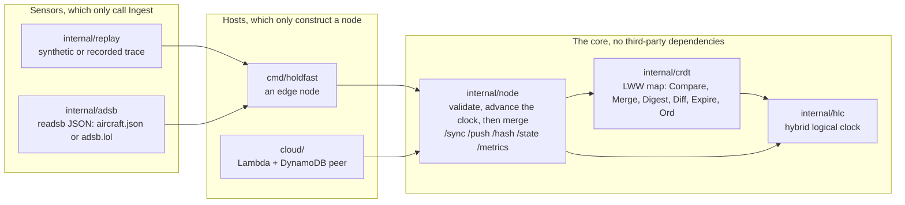

# holdfast design

How the pieces fit, what each one promises, and the evidence for every promise. Measured results are in the [README](../README.md).

## The pieces

Dependencies point inward. The clock knows nothing of the map, the map nothing of the network, and the node nothing of where reports come from or where it runs. The AWS SDK lives in its own Go module, so the edge binary has no third-party dependency at all.

Every untrusted input is checked in exactly one place before it touches state:

| Input | Checked in |
|---|---|
| A peer's message, request or response | `node.decode` and `node.post` (size, then one JSON value with no unknown fields and nothing after it), `node.validate` (track count, ids, origins, finite numbers in range, stamps not negative, within the max drift and with the logical part under its bound), `checkDigest` (entry count, ids, origins) and `syncOnce` (a response's want list under the cap) |
| The ADS-B feed | `adsb.Parse` (addresses, positions, position age, the response's own clock) |
| A trace file | `replay.Read` (one valid record per line, nothing after it) |
| A DynamoDB item | the cloud peer's `decode` (the stored ord must match the track), then `node.Restore`, which runs the same checks as a peer's message; what it refuses only for time (a stamp past this instance's drift limit) is not corrupt |

There is one definition of which of two values wins: `crdt.Compare`, a total order over (stamp, origin, contents). `crdt.Merge` applies it and `Map.Put` calls `Merge`, so the property tests check the rule the node runs. The cloud needs the same order as a string DynamoDB can compare, so `crdt.Ord` encodes it, and tests prove the two agree in Go and inside DynamoDB.

## Invariants

| Invariant | Enforced by |
|---|---|
| Merge is commutative, associative and idempotent, and Compare is a total order, so the map is a CRDT | `TestMergeIsCommutativeAssociativeIdempotent`, `TestCompareIsATotalOrder` (property tests, 2000 cases in the gate) |
| Replicas that exchange digests converge to the merge of every write | `TestReplicasConvergeThroughDigestExchange`, `TestStampTieWithDifferentContentsStillConverges`, `TestSimulation` |
| Every stored stamp is at or below the node's clock, so under the hybrid clock a local write never loses | `TestClockAdvancesPastTrackStampsNotJustTheMessageStamp`, `TestIngestStampsUnderTheLock`, `TestSimulation` (checked after every step), and `ingest_lost` in every measured run |
| A node's value for an aircraft only moves up in Compare's order, unless it expires | `TestSimulation` |
| A clean sync round leaves both sides holding the same picture | `TestSimulation` |
| Nothing from outside changes state unless it is valid, and every refusal, of a request or a response, is counted once | `TestTrustBoundaryRejectsBadMessages`, `TestARefusedResponseIsRejectedButACutOffOneIsNot`, `TestTrailingContentAfterAMessageIsRefused`, `FuzzHandlers` (judged by its own validity oracle, not the code under test), `FuzzParse`, `TestABadItemIsSkipped` |
| A refused message moves neither the replica nor the clock | `FuzzHandlers` (requests); `TestARefusedResponseIsRejectedButACutOffOneIsNot` (a refused response merges nothing) |
| After a restart and the startup hold, a node's stamps sort above every stamp that existed when it started | `TestRestartedNodesFreshReportWins`, `TestTheStartupHoldRunsOnTheNodesOwnClock`, `TestSimulation` |
| A held report never replaces a fresher observation that arrived during the hold | `TestTheHoldNeverStampsAReportOverAFresherOne` |
| The drift bound and the startup hold run on the node's own clock, and `/state` reports true time | `TestDriftIsMeasuredOnTheNodesOwnClock`, `TestTheStartupHoldRunsOnTheNodesOwnClock`, `TestStateReportsTrueTime`; `TestSimulation` gives every node its clock error through `ClockOffset`, as the clock-skew runs do |
| A replica never holds more than 10,000 aircraft, and the ones it holds still update | `TestAFullReplicaRefusesNewAircraft` |
| `ingest_lost` and `merge_applied`, behind published numbers, count only what their names say | `TestIngestLostCountsOnlyAFresherReportLosing`, `TestALosingOrRedeliveredTrackIsStaleNotApplied`, `TestMergeRegressCountsAStaleWinner` |
| An expired version never comes back to a node that expired it, and expiry commutes with merge | `TestExpireCommutesWithMerge`, `TestSimulation`, `TestAnExpireDuringAReceiveCannotBringAVersionBack` (the cutoff is read under the node lock, so a concurrent expire can't slip between reading it and merging) |
| `Ord(a) < Ord(b)` exactly when `Compare(a, b) < 0` | `TestOrdOrdersLikeCompare` (every pair of stamps with logical parts from 0 to 2^20 at real epoch walls, every pair of origins, then random ties on every other field), and `TestTheStoreKeepsWhatMergeKeeps` against DynamoDB Local itself, with logical parts from 0 to the cap |
| The cloud table's value for an aircraft only moves up, whatever order invocations land in and whatever each instance's clock reads; only an item no clock would accept is replaced by a smaller one | `TestConcurrentWritesLeaveTheLargestTrack`, `TestASlowerInstanceNeverMovesTheTableDown` |
| Dependencies point inward, and only the cloud peer uses third-party code | `TestDependenciesPointInward` |

Each of these has planted bugs that the tests must catch: `scripts/mutants.sh` runs 131 of them on every gate, after first checking that the unmutated tests pass, so a broken environment can't pass for a caught bug.

`TestSimulation` runs three or four nodes in one goroutine on a fake clock and draws every fault from a seed: lost, delayed, duplicated and cut-off messages, lost responses, partitions, clock jumps in both directions, restarts that wipe a node, two reports in the same millisecond, and aircraft that arrive and go quiet. It checks the invariants after every step and fails if the schedules stop exercising any of those paths. A failure replays exactly from its seed. It found two real bugs before any measurement saw them: a restarted node reusing its old stamps, and expired tracks coming back after a clock stepped back. A fresh review then found what a single goroutine can't: an expire landing between a receive reading its cutoff and taking the lock, and a corrupt table item blocking every valid write for its aircraft. Both are fixed, each with a test that fails on the old code. A later audit, four reviewers each on one subsystem, then found 27 planted bugs the tests let through (the simulation never gave a node its error through `ClockOffset`, and the fuzzer judged validity with the code under test), plus real defects: a corrupt item whose ord isn't a string still blocking its aircraft, a slower cloud instance able to move the table down, a feed header able to silence a sensor for a day, and a replica with no bound. Each is fixed with a test that fails on the old code, and the tests now kill all of those 27 but one, which is equivalent to the original code.

## Failure modes

| What goes wrong | What happens | Evidence |
|---|---|---|
| Messages lost, delayed, duplicated, reordered | Nothing is retried; the next round resends. Every exchange is idempotent. | `TestSimulation`; the loss sweeps in the README |
| A request cut off mid-upload | Counted as aborted, not as a rejection | `TestCutOffBodyIsAbortedNotRejected` |
| A sync response cut off mid-body, by a timeout or a dropped link | A failed round, in `sync_err` only, never a rejection | `TestARefusedResponseIsRejectedButACutOffOneIsNot` |
| A node partitioned, then healed | The rest keep syncing; the cut node catches up in about a second | `TestPartitionedNodeCatchesUpAfterHeal`; partition runs |
| The star's hub, or the cloud relay, cut | Edges merge nothing from each other until it returns | `merged_cut` in the hub-cut runs |
| 50% packet loss | Most rounds fail and latency climbs, whatever the client timeout: a request and response over TCP rarely finish | the loss50 runs and `harness/tcp_probe.py` |
| A node's clock slow or fast, under the max drift | The hybrid clock orders its writes after what it has seen; the wall clock loses writes once the skew passes the report interval | `TestSlowClockFreshWriteWinsOnlyUnderHLC`; the clock-skew runs |
| A peer's clock past the max drift | Its whole message is refused, so one broken clock can't drag everyone's forward | `TestTrustBoundaryRejectsBadMessages` |
| A node's clock steps back | The clock never goes back; expiry never moves back either | `TestNowNeverGoesBackwards`, `TestSimulation` |
| A node restarts empty | It holds its own reports for the max drift (5 s) on its own clock, then stamps above everything that existed when it started. It skips a held report older than one a peer delivered during the hold | `TestRestartedNodesFreshReportWins`, `TestTheStartupHoldRunsOnTheNodesOwnClock`, `TestTheHoldNeverStampsAReportOverAFresherOne` |
| A sensor delivers an older position after a fresher one arrived elsewhere | Last-writer-wins keeps the older one: it orders writes, not observations. Counted as `ingest_regress` and `merge_regress` | `TestIngestRegressCountsAnOlderLocalReportWinning`; measured on the recorded hour |
| The feed is down, refusing, or sends garbage | Every failed poll backs off: the wait doubles up to 30 s, is never shorter than the normal interval, and honors Retry-After (seconds or a date) up to 5 minutes, so one header can't silence a sensor for longer. Each failure's log line says when the next poll comes. Bad aircraft are skipped; a response with a wrong clock is refused; the node keeps syncing what it has | `TestFollowReportsAndSurvivesABadFeed`, `TestEveryFailedPollBacksOffAndSaysForHowLong`, `TestASlowFailureStillWaitsTheBackoffItLogs`, `TestPollReadsRetryAfter`, `TestBackoffNeverUndercutsTheIntervalOrRetryAfter`, `FuzzParse` |
| A hostile peer sends malformed or oversized messages, or more after one, as a request or as a response | Refused and counted as rejected once; nothing changes. The refusal's text is cut to 300 characters, so a megabyte id or field name isn't echoed back | `TestTrustBoundaryRejectsBadMessages`, `TestARefusedResponseIsRejectedButACutOffOneIsNot`, `TestTrailingContentAfterAMessageIsRefused`, `TestARefusalDoesNotEchoAHugeInput`, `FuzzHandlers` |
| A partition longer than the track TTL | Each side expires what it stopped hearing about, as a lone node does. At the heal the fresh versions merge, and a version one side already expired is refused, so nothing comes back; until the slower clock expires it too, the two disagree on that one track | `TestAPartitionLongerThanTheTTLBringsNothingBack` |
| More than 10,000 live aircraft, or a peer pushing made-up ones | A replica holds at most 10,000. Once full, it refuses a track for any aircraft it doesn't hold, counted as `capped`, and keeps updating the ones it holds, so memory stays bounded and a digest always fits. Nodes that filled with different aircraft disagree on the rest until expiry makes room. Expiry keeps a live picture far below the cap | `TestAFullReplicaRefusesNewAircraft`; the digest cap: `TestTrustBoundaryRejectsBadMessages`. A known limit, below |
| An aircraft nobody reports any more | Expires after the track TTL (5 min) on every node, peers or not, and in the cloud table through DynamoDB's own TTL; the cloud never serves an item it has expired | `TestExpireCommutesWithMerge`, `TestSimulation`, `TestALoneNodeStillExpires`, `TestRestoreLeavesOutExpiredTracks`, `TestItemsExpireWithTheirTrack` |
| Concurrent Lambda invocations, or an SDK retry of a write that landed | Conditional writes only let a greater track in; a lost condition is a lost merge, not an error | `TestConcurrentWritesLeaveTheLargestTrack`, `TestTheStoreKeepsWhatMergeKeeps` |
| DynamoDB throttles or fails mid-request | The request answers 503 after what it could write; the edge's next round resends the rest | `TestAStoreFailureMidRequestLosesNothing` (one write fails at the transport: 503, the others land, the next round completes the table); real throttling is not load-tested |
| A tampered or corrupt table item | Skipped and counted, never served, and the next valid write for that aircraft replaces exactly that item, whatever its ord holds: a string, another type, or nothing. Corrupt means what a node with no drift limit and no expiry would still refuse. A valid track only stamped past this instance's drift limit, as one written through an instance whose clock runs ahead can be, is not corrupt: the ordinary condition decides it, and this instance serves it once its own clock catches up | `TestABadItemIsSkipped`, `TestAValidWriteReplacesABadItem`, `TestASlowerInstanceNeverMovesTheTableDown` |
| A wrong or missing token at the cloud | 401; in Lambda, a token under 32 characters stops the function at start | `TestTokenIsRequired`, `TestLambdaRefusesAShortToken`, `scripts/lambda_smoke.py` (a wrong token and none, on a linux/amd64 build) |
| The cloud's token sent to the wrong peer, or in the clear | Never: only requests for the `-cloud-peer` host carry it, only over https or to a private IP, and over http never through a proxy (over https a proxy sees only a CONNECT) | `TestTheTokenGoesOnlyToTheCloudPeer`, `TestTheTokenNeverCrossesAProxyInTheClear`, `TestCloudURLKeepsTheTokenOffCleartextLinks`; every cloud harness run, the gate's smoke run among them, authenticates with a fresh token |
| A bad flag: a peer, feed or cloud URL that isn't an http(s) base URL with a host and no user, query or fragment, the same peer twice, no sync timeout, a live-feed interval under 1 s, a negative trace length or offset, an offset past the trace's last record, a start more than 5 s past | Refused at startup with a message naming the flag. A window with nothing in this node's coverage still starts, as some windows of the recorded hour have for some sensors | `TestBadFlagsAreRefusedAtStartup`, `TestTheHarnessFlagsStillStart`, `TestCloudURLKeepsTheTokenOffCleartextLinks` |
| A trace line with more after its record, a coverage of NaN or infinite radius, or a recorder sensor id the trace format refuses | Refused when the trace or the flag is read | `TestReadRejectsBadLines`, `TestCircle`, `TestSensorFlag` |
| A stop while a peer's upload is still arriving, or a trace is replaying | The 5 s shutdown budget runs out, the rest is cut off and logged as forced, and the node exits 0; the peer still holds what it was sending. A replay stops at once, even with records overdue | `TestShutdownCutsOffAnUploadThatOutlastsItsBudget`, `TestPlayStopsOnACancelledContextEvenForRecordsAlreadyDue` |

## Known limits

Heaviest first.

- **No authentication between edge nodes, and one shared token for the cloud.** Origins are self-asserted, so anyone who can reach a node can write to it as any origin. Node identity, mutual TLS with short-lived certificates, would close it; it is out of scope here.
- **Last-writer-wins, not sensor fusion.** The merge keeps the latest write, not the best estimate: no Kalman filtering, no weighting by the quality fields ADS-B carries, no plausibility checks against spoofed positions.
- **TCP request/response is the wrong transport for a link that drops half its packets**; small idempotent datagrams would be the next experiment.
- **Measured on one host, with loss and cuts only, and three edges.** No latency, bandwidth cap or reordering was injected, so every link had a sub-millisecond round trip, and peers are a static list with no membership. Real tactical links and more nodes are untested.
- **Every cloud request reads the whole table**, so the cloud's read cost grows with the number of aircraft, and with edges times rounds a second. The AWS run read 7,028 units over 1,758 requests with 12 or 13 aircraft, about 4 a request. The harness measures it (`cloud_requests`, and items read per request at `/peer`).
- **A replica holds at most 10,000 aircraft**, the most one digest carries. Past that a node refuses new aircraft until expiry makes room, so a busy sky, or a peer pushing made-up aircraft (there is no authentication, above), can keep new ones out. Paged digests or Merkle ranges are the upgrade; expiry keeps a live picture far below that today.
- **No persistence on the edge nodes.** A restart starts empty and refills from peers.
- **Expiry is decided by each node's clock**, and a node drops an expired track on its next sync round, not the moment it expires. So replicas disagree about a track near its expiry for the clock spread plus up to one sync interval: at most 6 s at the defaults (5 s max drift, 1 s interval), against a 5 minute TTL. A cutoff never moves back, so a clock that stepped back counts at its highest. Until that round, `/hash` and `/state` still show the expired track.
- **A table item stamped ahead of every clock, but within 292 years, holds its aircraft until real time reaches its stamp.** Only what no clock would accept counts as corrupt, so a slower instance can't replace a valid track that is merely early. The price: an item planted with a stamp, say, a day ahead is treated as merely early too, and the cloud takes no write for that aircraft until that day. Only an instance whose clock is that far wrong, or something with direct write access to the table, can put one there.
- **A clock rollover can overshoot the drift bound by 1 ms.** A stamp exactly at a node's drift limit with its logical part at the maximum moves that node's clock to the next millisecond, and a peer whose limit is the same refuses its messages until its own clock moves on by that millisecond.
- **JSON field names match whatever their case, and a repeated key keeps its last value**, as Go's `encoding/json` decides. Nothing in front of a node parses its messages (API Gateway passes the body through), so no second reader can see one differently; a proxy that validated messages itself would have to decide the same way.
