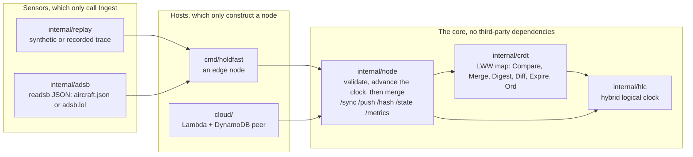

# holdfast design

How the pieces fit, what each one promises, and the evidence for every promise. Measured results are in the [README](../README.md).

## The pieces

Dependencies point inward. The clock knows nothing of the map, the map nothing of the network, and the node nothing of where reports come from or where it runs. The AWS SDK lives in its own Go module, so the edge binary has no third-party dependency at all.

Every untrusted input is checked in exactly one place before it touches state:

| Input | Checked in |
|---|---|
| A peer's message | `node.decode`, `node.validate`, `checkDigest` (sizes, ids, origins, finite numbers, stamps within the max drift, logical part under its bound) |
| The ADS-B feed | `adsb.Parse` (addresses, positions, position age, the response's own clock) |
| A trace file | `replay.Read` |
| A DynamoDB item | the cloud peer's `decode` (the stored ord must match the track), then `node.Restore`, which runs the same checks as a peer's message |

There is one definition of which of two values wins: `crdt.Compare`, a total order over (stamp, origin, contents). The cloud needs the same order as a string DynamoDB can compare, so `crdt.Ord` encodes it, and tests prove the two agree in Go and inside DynamoDB.

## Invariants

| Invariant | Enforced by |
|---|---|
| Merge is commutative, associative and idempotent, and Compare is a total order, so the map is a CRDT | `TestMergeIsCommutativeAssociativeIdempotent`, `TestCompareIsATotalOrder` (property tests, 2000 cases in the gate) |
| Replicas that exchange digests converge to the merge of every write | `TestReplicasConvergeThroughDigestExchange`, `TestStampTieWithDifferentContentsStillConverges`, `TestSimulation` |
| Every stored stamp is at or below the node's clock, so under the hybrid clock a local write never loses | `TestClockAdvancesPastTrackStampsNotJustTheMessageStamp`, `TestIngestStampsUnderTheLock`, `TestSimulation` (checked after every step), and `ingest_lost` in every measured run |
| A node's value for an aircraft only moves up in Compare's order, unless it expires | `TestSimulation` |
| A clean sync round leaves both sides holding the same picture | `TestSimulation` |
| Nothing from outside changes state unless it is valid, and every refusal is counted once | `TestTrustBoundaryRejectsBadMessages`, `FuzzHandlers`, `FuzzParse`, `TestABadItemIsSkipped` |
| A refused message moves neither the replica nor the clock | `FuzzHandlers` |
| After a restart and the startup hold, a node's stamps sort above every stamp that existed when it started | `TestRestartedNodesFreshReportWins`, `TestSimulation` |
| An expired version never comes back to a node that expired it, and expiry commutes with merge | `TestExpireCommutesWithMerge`, `TestSimulation`, `TestAnExpireDuringAReceiveCannotBringAVersionBack` (the cutoff is read under the node lock, so a concurrent expire can't slip between reading it and merging) |
| `Ord(a) < Ord(b)` exactly when `Compare(a, b) < 0` | `TestOrdOrdersLikeCompare`, and `TestTheStoreKeepsWhatMergeKeeps` against DynamoDB Local itself |
| The cloud table's value for an aircraft only moves up, whatever order invocations land in | `TestConcurrentWritesLeaveTheLargestTrack` |

Each of these has planted bugs that the tests must catch: `scripts/mutants.sh` runs 66 of them on every gate, after first checking that the unmutated tests pass, so a broken environment can't pass for a caught bug.

`TestSimulation` deserves a word. It runs three or four nodes in one goroutine on a fake clock and draws every fault from a seed: lost, delayed, duplicated and cut-off messages, lost responses, partitions, clock jumps in both directions, restarts that wipe a node, two reports in the same millisecond, and aircraft that arrive and go quiet. It checks the invariants after every step and fails if the schedules stop exercising any of those paths. A failure replays exactly from its seed. It found two real bugs before any measurement saw them: a restarted node reusing its old stamps, and expired tracks coming back after a clock stepped back. An independent review then found what a single goroutine can't: an expire landing between a receive reading its cutoff and taking the lock, and a corrupt table item blocking every valid write for its aircraft. Both are fixed, each with a test that fails on the old code.

## Failure modes

| What goes wrong | What happens | Evidence |
|---|---|---|
| Messages lost, delayed, duplicated, reordered | Nothing is retried; the next round resends. Every exchange is idempotent. | `TestSimulation`; the loss sweeps in the README |
| A request cut off mid-upload | Counted as aborted, not as a rejection | `TestCutOffBodyIsAbortedNotRejected` |
| A node partitioned, then healed | The rest keep syncing; the cut node catches up in about a second | `TestPartitionedNodeCatchesUpAfterHeal`; partition runs |
| The star's hub, or the cloud relay, cut | Edges merge nothing from each other until it returns | `merged_cut` in the hub-cut runs |
| 50% packet loss | Most rounds fail and latency climbs, whatever the client timeout: a request and response over TCP rarely finish | the loss50 runs and `harness/tcp_probe.py` |
| A node's clock slow or fast, under the max drift | The hybrid clock orders its writes after what it has seen; the wall clock loses writes once the skew passes the report interval | `TestSlowClockFreshWriteWinsOnlyUnderHLC`; the clock-skew runs |
| A peer's clock past the max drift | Its whole message is refused, so one broken clock can't drag everyone's forward | `TestTrustBoundaryRejectsBadMessages` |
| A node's clock steps back | The clock never goes back; expiry never moves back either | `TestNowNeverGoesBackwards`, `TestSimulation` |
| A node restarts empty | It holds its own reports for the max drift (5 s), then stamps above everything that existed when it started | `TestRestartedNodesFreshReportWins` |
| A sensor delivers an older position after a fresher one arrived elsewhere | Last-writer-wins keeps the older one: it orders writes, not observations. Counted as `ingest_regress` and `merge_regress` | `TestIngestRegressCountsAnOlderLocalReportWinning`; measured on the recorded hour |
| The feed is down, refusing, or sends garbage | Polls fail and back off, never faster than the normal interval and never sooner than Retry-After asks; bad aircraft are skipped; a response with a wrong clock is refused; the node keeps syncing what it has | `TestFollowReportsAndSurvivesABadFeed`, `TestBackoffNeverUndercutsTheIntervalOrRetryAfter`, `FuzzParse` |
| A hostile peer sends malformed or oversized messages | Refused and counted; nothing changes | `TestTrustBoundaryRejectsBadMessages`, `FuzzHandlers` |
| An aircraft nobody reports any more | Expires after the track TTL (5 min) on every node, peers or not, and in the cloud table through DynamoDB's own TTL; the cloud never serves an item it has expired | `TestExpireCommutesWithMerge`, `TestSimulation`, `TestALoneNodeStillExpires`, `TestRestoreLeavesOutExpiredTracks`, `TestItemsExpireWithTheirTrack` |
| Concurrent Lambda invocations, or an SDK retry of a write that landed | Conditional writes only let a greater track in; a lost condition is a lost merge, not an error | `TestConcurrentWritesLeaveTheLargestTrack`, `TestTheStoreKeepsWhatMergeKeeps` |
| DynamoDB throttles or fails mid-request | The request answers 503 after what it could write; the edge's next round resends the rest | `TestAStoreFailureMidRequestLosesNothing` (one write fails at the transport: 503, the others land, the next round completes the table); real throttling is not load-tested |
| A tampered or corrupt table item | Skipped and counted, never served, and the next valid write for that aircraft replaces exactly that item | `TestABadItemIsSkipped`, `TestAValidWriteReplacesABadItem` |
| A wrong or missing token at the cloud | 401 | `TestTokenIsRequired`, `scripts/lambda_smoke.py` |
| The cloud's token sent to the wrong peer, or in the clear | Never: only requests for the `-cloud-peer` host carry it, and only over https or to a private IP | `TestTheTokenGoesOnlyToTheCloudPeer`, `TestCloudURLKeepsTheTokenOffCleartextLinks`; every cloud harness run, the gate's smoke run among them, authenticates with a fresh token |

## Known limits

- **No authentication between edge nodes, and one shared token for the cloud.** Origins are self-asserted, so anyone who can reach a node can write to it as any origin. Node identity (mutual TLS with short-lived certificates) is the next phase.
- **Last-writer-wins, not sensor fusion.** The merge keeps the latest write, not the best estimate: no Kalman filtering, no weighting by the quality fields ADS-B carries, no plausibility checks against spoofed positions.
- **A digest carries the whole picture**, so past 10,000 aircraft every sync would be refused. Paged digests or Merkle ranges are the upgrade; expiry keeps a live picture far below that today.
- **Expiry is decided by each node's clock**, so replicas disagree about a track near its expiry for as long as their clocks disagree, a few seconds against a 5 minute TTL.
- **No persistence on the edge nodes.** A restart starts empty and refills from peers.
- **A clock rollover can overshoot the drift bound by 1 ms.** A stamp exactly at a node's drift limit with its logical part at the maximum moves that node's clock to the next millisecond, and a peer whose limit is the same refuses its messages until its own clock moves on by that millisecond.
- **Every cloud request reads the whole table**, so the cloud's read cost grows with the number of aircraft. The harness measures it (`cloud_requests`, and items read per request at `/peer`).
- **TCP request/response is the wrong transport for a link that drops half its packets**; small idempotent datagrams would be the next experiment.
